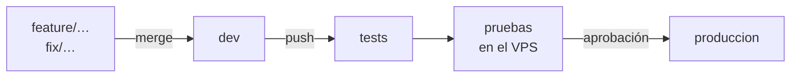
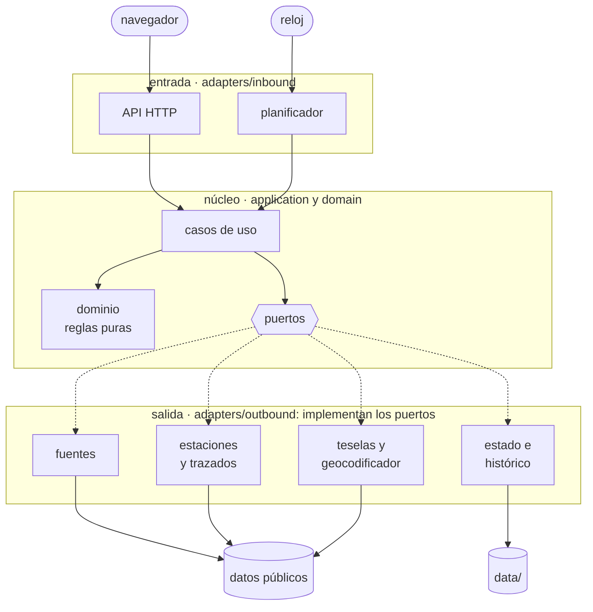
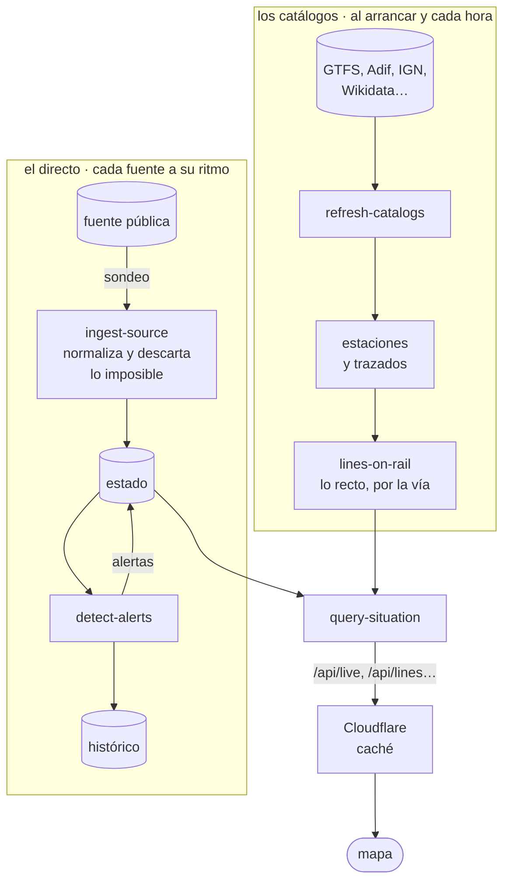

<p align="center"></p>

# Radar España

**[radarespaña.es](https://radarespaña.es)** (también [radarespana.es](https://radarespana.es)) · Mapa
de trenes, metros, tranvías y autobuses de España, cruzado con incidencias de tráfico, terremotos,
avisos meteorológicos, incendios, el estado de la red eléctrica y los avisos oficiales de protección
civil (planes de emergencia activados y cortes de luz). Los vehículos salen en su posición
en directo cuando el operador la publica y, si solo publica su horario, en una posición estimada
marcada como tal. Todo a partir de **datos públicos**: de sus 58 fuentes, 32 no piden nada, 25
necesitan la clave gratuita del Punto de Acceso Nacional (NAP) y 1 la de e·sios (Red Eléctrica).

Un motor de reglas vigila situaciones que merecen atención humana: trenes detenidos en
plena vía, varios trenes parados en la misma zona, saltos bruscos de retraso, desapariciones
masivas de trenes del mapa, terremotos, incendios o avisos naranja y rojo cerca de trenes en
circulación, alertas de catástrofes naranja o roja, caídas de la demanda eléctrica (peninsular y
de cada isla de Canarias, Ceuta y Melilla), cortes de luz y
planes de emergencia en alerta que publican protección civil y los 112, y fuentes de datos caídas.

> **Límites.** Los datos públicos llegan con decenas de segundos o minutos de retraso y no
> incluyen señalización, estado de la vía ni comunicaciones con el maquinista. Esta
> herramienta sirve para vigilar y dar contexto; **no** para tomar decisiones de seguridad
> operativa, que corresponden a Adif y a los operadores.

## Arranque

```bash
npm install
cp .env.example .env   # opcional
npm start              # http://127.0.0.1:8080
npm run dev            # se reinicia al cambiar el código
npm test               # todos los tests, sin red: dominio, casos de uso, adaptadores y web
node --test test/domain/rules.test.js   # un solo fichero
```

Requiere Node.js 22.9 o superior. Para los trazados de líneas y las posiciones estimadas por
horario hace falta `NAP_API_KEY` en `.env` (clave gratuita del Punto de Acceso Nacional): sin ella
se desactivan las 25 fuentes que la necesitan, y el registro lo avisa al arrancar. Los avisos de EMT
Madrid usan además, si están, `EMT_MADRID_CLIENT_ID` y `EMT_MADRID_PASSKEY`, de una aplicación gratuita
en [MobilityLabs](https://mobilitylabs.emtmadrid.es); sin ellas, o si EMT no las acepta, se leen sin
identificarse. El primer
arranque descarga los horarios GTFS en `data/` y tarda unos minutos; los siguientes los leen de ahí.
Para contar visitas en producción se pone `GOATCOUNTER_URL` (GoatCounter, sin cookies); sin ella
no se carga ningún contador y la página de privacidad lo indica. Con `ESIOS_TOKEN` (clave gratuita de
Red Eléctrica, que se pide desde la web de [e·sios](https://www.esios.ree.es/)) se vigila la demanda de cada
isla de Canarias, Ceuta y Melilla; sin ella esa fuente se desactiva. Su aviso legal sólo permite enlazar
la portada de sus webs.

## Ramas

| Rama | Para qué |
|---|---|
| `produccion` | Lo que ejecuta el VPS. Solo recibe fusiones desde `dev`. |
| `dev` | Integración: aquí se fusionan las mejoras, y el VPS las prueba juntas en un entorno de pruebas. |
| `feature/<nombre>`, `fix/<nombre>` | Una rama por mejora o por arreglo, creada desde `dev`. |

```bash
git switch dev && git pull
git switch -c feature/mi-mejora     # trabajar y hacer commits
git switch dev && git merge --no-ff feature/mi-mejora && git push
```



Cada push a `dev` arranca el pipeline de GitHub Actions: tests, pruebas en el VPS y, cuando están
en verde, una aprobación manual que hace el merge de `dev` en `produccion`. Además de los tests, la
integración continua comprueba la sintaxis del código de la web (`node --check`) y de los scripts de
despliegue (`bash -n`).

En producción corre con Docker en un VPS detrás de un túnel de Cloudflare. Cada cambio en `dev`
pasa antes por un entorno de pruebas en el mismo VPS, y producción sólo despliega lo que ya ha
superado allí la comprobación, con la misma imagen: ver [`docs/despliegue.md`](docs/despliegue.md).

## Arquitectura hexagonal

Quien llama entra por arriba; el núcleo no sabe nada de red ni de disco, y todo lo externo queda
abajo, detrás de un puerto:



| Capa | Carpeta | Qué hay |
|---|---|---|
| Entrada | `adapters/inbound/` | `http/http-server.js` (API, teselas y web) y `scheduler/polling-scheduler.js` (sondeo, alertas y catálogos) |
| Casos de uso | `application/use-cases/` | `ingest-source`, `detect-alerts`, `query-situation`, `serve-tiles`, `refresh-catalogs` y `lines-on-rail` |
| Puertos | `application/ports.js` | los contratos que piden los casos de uso (tabla de abajo) |
| Dominio | `domain/` | `model`, `geo`, `tracking`, `kpis`, `tiles`, `schedule`, `estimated-position`, `route-ahead`, `rail-match`, `alerts/` (`rules`, `lifecycle`, `thresholds`), `emergencias`, `lugares` y `red-aislada` |
| Salida | `adapters/outbound/` | `sources/` (una por fuente), `stations/` (estaciones, Wikidata y Commons), `network/`, `gtfs/` y `nap/` (trazados y redes de Adif e IGN), `persistence/` (estado en memoria e histórico JSONL), `tiles/` (teselas de IGN y EFFIS), `geo/` (CartoCiudad), `workers/` (hilos de CPU), `http/` y `logging/` |

- **`server/domain/`**: modelo y reglas puras. Se prueba sin red (`test/domain`).
- **`server/application/`**: casos de uso y **puertos**, los contratos que necesitan del exterior.
- **`server/adapters/outbound/`**: implementaciones de esos puertos. Para cambiar la memoria
  por Redis o Postgres, o el JSONL por una base de datos, basta con escribir otro adaptador.
- **`server/adapters/outbound/workers/`**: hilos (`worker_threads`) para el trabajo de CPU de los
  adaptadores: leer los horarios GTFS, construir los trazados y analizar el XML de la DGT. Sólo
  calculan; las descargas y el estado siguen en el hilo principal. **Desactivados por defecto**:
  se activan con `WORKER_THREADS=2` en `.env` (arranque ~20 % más rápido, pero cada hilo carga sus
  propios horarios y el pico de memoria sube). Si un hilo falla, el trabajo se repite en el principal.
- **`server/adapters/inbound/`**: quien dispara los casos de uso (la API HTTP y el planificador).
  Sólo hablan con casos de uso; de los puertos de salida sólo usan el registro (`Logger`).
- **`server/main.js`**: raíz de composición; el único sitio donde se eligen las implementaciones.
  Al arrancar comprueba con `assertPort` que cada adaptador tiene todo lo que pide su puerto.

### Del dato al mapa

Cada fuente se lee a su ritmo y lo que llega se guarda en el estado; los catálogos (estaciones,
trazados y redes de vías) se recargan al arrancar y cada hora. La web sólo pregunta: no hay
conexiones abiertas con cada visita, y Cloudflare reparte las mismas respuestas a todas.



Los puertos están en `server/application/ports.js`:

| Puerto | Adaptador | Para qué |
|---|---|---|
| `DataSource` | `sources/*` (uno por fuente) | leer cada fuente: vehículos, incidencias o métricas |
| `StationCatalog` | `stations/renfe-station-catalog.js`, `stations/network-station-catalog.js` | estaciones de Renfe y de las demás redes |
| `NetworkCatalog` | `network/gtfs-network-catalog.js`, a través del caso de uso `lines-on-rail` | trazados de las líneas; los tramos que van en recta entre estaciones se rehacen por la vía |
| `RailNetwork` | `network/adif-rail-network.js`, `network/ign-rail-network.js` | red de Adif, para dibujar por la vía AVE, Larga y Media Distancia; red del IGN (también metro, tranvía y funicular), para rehacer por la vía los trazados en recta y los de Ouigo |
| `SituationRepository` | `persistence/in-memory-situation.js` | estado actual: último dato de cada fuente, recorridos, alertas, KPIs |
| `History` | `persistence/jsonl-history.js` | histórico de alertas y KPIs |
| `TileProvider` | `tiles/wms-tiles.js` | teselas de IGN y EFFIS con copia en disco |
| `Geocoder` | `geo/cartociudad-geocoder.js` | situar el municipio que cita un aviso del 112 (no traen coordenadas). Lo usan las fuentes de avisos, no los casos de uso: su contrato está en el propio adaptador |

`Clock` (la hora, para poder simularla en los tests) y `Logger` (el registro) también son puertos.

### Añadir una fuente

1. Crea `server/adapters/outbound/sources/mi-fuente.js` que devuelva un objeto con el puerto
   `DataSource`: `{ id, name, kind: 'vehicles'|'events'|'metrics', interval, fetch() }`.
   Si publica **GTFS-Realtime**, no hace falta código: reutiliza `createGtfsRtVehicleSource`.
2. Regístrala en `server/adapters/outbound/sources/index.js`.
3. Si necesita clave, declara `requires: ['MI_CLAVE']`. Se activará sola cuando la variable
   exista en `.env`.
4. Si la URL del dato no es una página para personas (un JSON, un .pb), añade `page` con la ficha
   pública del conjunto de datos: es lo que enlaza el panel de Fuentes.
5. Añade su fila de licencia y atribución en `public/legal.html`.

### Añadir una regla de alerta

Escribe una función pura `(ctx) => Alert[]` en `server/domain/alerts/rules.js`, añádela a
`RULES` y pruébala en `test/domain/rules.test.js`. Los umbrales están en `thresholds.js`.

## Fuentes integradas (todas verificadas)

Solo se usan fuentes con licencia de reutilización. Los endpoints internos de visores o apps
(el visor web de Renfe, la API del tranvía de Tenerife, la API de la app de Rodalies…) se descartaron
tras revisar sus avisos legales. Del tranvía de Tenerife solo se dibuja el trazado, que Metrotenerife
publica con licencia CC BY en el portal del Cabildo. La licencia y la atribución de cada fuente están
en `/legal`.

Todas son públicas. Las marcadas con 🔑 necesitan una clave gratuita: casi todas, la del NAP
(`NAP_API_KEY`); la de e·sios, la de Red Eléctrica (`ESIOS_TOKEN`). En total son 58 fuentes (34 de vehículos, 22 de incidencias y 2 de métricas):
32 sin clave, 25 con la del NAP y 1 con la de e·sios.

| Fuente | Qué aporta | Refresco |
|---|---|---|
| Renfe Cercanías/Rodalies (GTFS-RT `gtfsrt.renfe.com/vehicle_positions.json` + `trip_updates.json`) | posición, línea, retraso y estación; origen, destino, próxima parada y recorrido desde las paradas de cada viaje de su GTFS | 20 s |
| Renfe AV/LD/MD (GTFS-RT `vehicle_positions_LD.json` + `trip_updates_LD.json`) | posición y retraso; producto (AVE, Alvia…), origen y destino desde su GTFS | 20 s |
| Renfe GTFS-RT alerts + trip updates (`alerts.json`, `trip_updates.json`) | avisos de servicio y trenes de Cercanías/Rodalies cancelados | 2 min |
| Estaciones Renfe (lista oficial `estaciones.csv` + paradas de sus GTFS) | nombres y coordenadas de ~1.530 estaciones | 24 h |
| FGC (`dadesobertes.fgc.cat`, `posicionament-dels-trens`) | posición y si va en hora | 30 s |
| Rodalies de Catalunya (RSS «Estat del servei» de la Generalitat) | avisos por línea (p. ej. transporte por carretera) | 3 min |
| Metro Bilbao (GTFS-RT y GTFS, Open Data Euskadi) | posición; nombres de estación, origen, destino y recorrido desde su GTFS | 30 s |
| 🔑 Euskotren (GTFS del NAP + trip updates de Open Data Euskadi) | **posición estimada** con su **retraso real** | 30 s |
| 🔑 Ouigo (GTFS del NAP) | **posición estimada** por horario, marcada como tal | 30 s |
| 🔑 Metros y tranvías sin GPS (GTFS del NAP) | **posición estimada** por horario en Barcelona (Metro, TRAM), Madrid (Metro Ligero), Valencia, Alicante, Sevilla, Málaga, Granada, Zaragoza y Murcia | 30 s |
| Autobuses de Euskadi (~25 operadores), EMT Málaga, EMT Fuenlabrada (GTFS-RT) | posición; capa oculta por defecto y fuera de las alertas | 60 s |
| 🔑 ALSA (GTFS del NAP) | **posición estimada** por horario de sus autobuses (nadie publica su tiempo real); capa de autobuses | 60 s |
| 🔑 AMB (GTFS del NAP + trip updates de `ambmobilitat.cat`) | autobús metropolitano de Barcelona: **posición estimada** con su **retraso real** | 60 s |
| Autobuses La Unión (GTFS-RT, NAP) y AUVASA Valladolid (GTFS-RT, CC BY 3.0 ES) | posición | 60 s |
| 🔑 83 horarios de autobús del NAP, en 9 grupos (`autobuses-nap.js`) | **posición estimada** de Avanza, Sagalés, Moventis, Grupo Ruiz, AISA, Vectalia, urbanos de ciudades, interurbanos autonómicos e insulares y otras empresas | 60 s |
| EMT Madrid (GTFS-RT, listado en el NAP; con las claves gratuitas de MobilityLabs si están) | avisos de servicio | 5 min |
| 🔑 GTFS de 16 redes en el NAP + líneas del tranvía de Tenerife (Cabildo de Tenerife) | trazados de Cercanías, metros, tranvías, FGC y Euskotren | 24 h |
| Adif, «Tramos en servicio» ([datos abiertos de Adif en ArcGIS](https://www.arcgis.com/home/item.html?id=4ec7c0fb3cab42b0b488d65e65eeb7aa)) | vías en servicio, para dibujar por la vía el recorrido de AVE, Larga y Media Distancia y lo que les queda | 30 días |
| IGN-CNIG, red ferroviaria de la IGR-RT (WFS INSPIRE de transportes `servicios.idee.es`, CC BY 4.0) | vías de toda España, también de metro, tranvía y funicular, para rehacer por la vía los trazados que van en recta entre estaciones y los que no se publican (Ouigo) | 30 días |
| DGT DATEX II v3.7 (`nap.dgt.es`) | ~1.000 incidencias de tráfico | 5 min |
| Servei Català de Trànsit (GML) | incidencias de carreteras catalanas | 5 min |
| Tráfico Euskadi (API Trafikoa) | incidencias de carreteras vascas | 5 min |
| AEMET avisos (RSS + CAP) | avisos amarillo, naranja y rojo **con polígono** | 10 min |
| NASA FIRMS (VIIRS NOAA-20, CSV público) | focos de calor por satélite (España, Portugal, Canarias) | 1 h |
| IGN sismología (GeoRSS) | terremotos de los últimos 10 días | 3 min |
| GDACS (ONU / Comisión Europea) | alertas de catástrofes en la zona (verde, naranja, roja) | 15 min |
| Copernicus EFFIS (WMS, servido por `/tiles` con copia de 3 h) | capa de áreas quemadas en los últimos 30 días y su ficha | — |
| Red Eléctrica REData | demanda real frente a prevista | 5 min |
| 🔑 Red Eléctrica e·sios (`ESIOS_TOKEN`) | demanda real y programada de cada isla o grupo de islas de Canarias, Ceuta y Melilla | 5 min |
| Gobierno de Canarias (alertas del PLATECA, CC BY 4.0) | prealerta, alerta y emergencia por isla, incluidos los ceros energéticos | 5 min |
| Generalitat de Catalunya (planes de protección civil activados) | planes en prealerta, alerta o emergencia | 5 min |
| Junta de Andalucía (noticias de Emergencias 112, CC BY 4.0) | planes activados y cortes de luz en los pueblos que citan | 10 min |
| 112 Castilla-La Mancha (RSS de planes) | PLATECAM, METEOCAM… activados por provincia | 10 min |
| SOS Rioja 112 (RSS) | averías del suministro eléctrico por pueblo y cuándo vuelve la luz | 10 min |
| 112 Castilla y León (RSS de última hora) | cortes de luz por localidad | 3 min |
| Govern de les Illes Balears (RSS de la sala de prensa, CC BY) | alertas y emergencias por isla y su fin, cortes de luz | 15 min |
| Comunidad de Madrid (RSS «Últimas noticias», aviso legal del portal) | planes de emergencia con nombre (PLATERCAM…) y cortes de luz de sus notas de prensa | 15 min |
| Región de Murcia (noticias de la CARM, datos abiertos) | planes de emergencia con nombre (PLATEMUR…) y cortes de luz de sus noticias | 15 min |
| Gobierno de Cantabria (RSS de notas de prensa, CC BY 3.0 ES) | planes de emergencia con nombre (PLATERCANT…) y cortes de luz; solo el día, sin hora | 15 min |
| Xunta de Galicia (RSS de notas de prensa: Emergencias y todas) | PLATERGA, alertas por nivel por provincia y cortes de luz | 10 min |
| Gobierno Vasco (RSS de noticias de Seguridad en Irekia, Open Data Euskadi, CC BY 4.0) | planes de emergencia con nombre (LABI, ITSASERTZA…) por territorio histórico y cortes de luz | 15 min |
| CartoCiudad (IGN-CNIG, CC BY 4.0) | ubicación de los pueblos que citan esos avisos | al leerlos |

El mapa base es de OpenFreeMap (datos de OpenStreetMap), sin clave.

Las posiciones estimadas (`estimated: true`) se dibujan como un anillo hueco y **no cuentan para
las alertas ni para los KPIs**.

### Emergencias y cortes de luz: qué hay de cada comunidad

Para ser transparentes con lo que se ve y con lo que **no** se ve. Revisado el 2-11-2026: de cada
fuente se leyó su licencia o aviso legal y su robots.txt. Solo se usan las que permiten reutilizar sus
datos. Ninguna sustituye a los avisos oficiales: ante una emergencia, llama al **112**.

**En toda España**
- Avisos meteorológicos de AEMET (amarillo, naranja y rojo, con su zona), terremotos del IGN,
  focos de calor de la NASA, áreas quemadas de Copernicus y alertas de catástrofes de GDACS.
- Apagón general de la península: alerta si la demanda eléctrica de Red Eléctrica (REData) cae muy
  por debajo de la prevista, como el 28-4-2025. Un corte local o de una comunidad no se nota ahí.
- Lo que **no publica nadie** como datos abiertos:
  - **Cortes de luz por calle o por barrio.** Solo los conocen las distribuidoras eléctricas
    (e-distribución, i-DE, UFD, E-Redes, Viesgo…). Ninguna los publica con licencia de
    reutilización, y e-distribución lo prohíbe expresamente.
  - **Avisos de Protección Civil del Estado y de ES-Alert.** No tienen ningún canal (RSS ni API) que
    se pueda leer.

**Por comunidad.** «Avisos oficiales» son los planes de protección civil activados y los cortes de
luz que publica cada administración. «Apagón total» es la alerta automática con la demanda de cada
sistema eléctrico aislado (e·sios, Red Eléctrica): llega a los pocos minutos, antes que el aviso
oficial.

| Comunidad | Avisos oficiales | Apagón total automático | Fuente o motivo |
|---|---|---|---|
| Andalucía | ✅ Planes activados y cortes de luz en los pueblos que citan | Solo el general de la península | Noticias de Emergencias 112 de la Junta (CC BY 4.0) |
| Aragón | ❌ | Solo el general de la península | Licencia contradictoria (el pie de la web dice CC BY 4.0 y el aviso legal, «uso personal», sin fines comerciales ni modificación) y ningún conjunto de emergencias |
| Asturias | ❌ | Solo el general de la península | Ni el 112 (SEPA) ni las noticias del Principado tienen RSS, solo páginas web. La licencia no comercial es la de la app del 112, no la de su web; asturias.es publica con CC BY 4.0 |
| Illes Balears | ✅ Alertas y emergencias por isla, su fin y cortes de luz | ❌ | Sala de prensa del Govern, en catalán (CC BY, conjunto de su catálogo de datos abiertos). Su robots.txt prohíbe esa ruta, en contra de su propio catálogo: se usa la URL exacta que publica el catálogo cada 15 minutos y se pide confirmación al Govern; si no lo aceptan, se retira. Red Eléctrica no publica en tiempo real la demanda real de Baleares, solo la programada |
| Canarias | ✅ Declaraciones del PLATECA por isla (prealerta, alerta, emergencia y su fin), ceros energéticos incluidos | ✅ Cada isla o grupo de islas | Gobierno de Canarias (CC BY 4.0) y e·sios |
| Cantabria | ✅ Planes con nombre (PLATERCANT, INFOCANT…) y cortes de luz de las notas de prensa del Gobierno | Solo el general de la península | RSS de notas de prensa de www.cantabria.es (CC BY 3.0 ES). Solo da el día, sin hora: una nota cuenta desde el mediodía. El RSS del 112 publica poco y va con semanas de retraso |
| Castilla-La Mancha | ✅ Planes activados por provincia (PLATECAM, METEOCAM…) | Solo el general de la península | RSS del 112 Castilla-La Mancha (aviso legal: reutilización citando la fuente) |
| Castilla y León | ✅ Cortes de luz por localidad | Solo el general de la península | RSS «Última hora» del 112 (condiciones de reutilización de la Junta) |
| Cataluña | ✅ Planes activados (fase y comunicado del CECAT), sin comarcas | Solo el general de la península | Conjunto «Plans de protecció civil activats» (Llicència oberta de Catalunya) |
| Comunitat Valenciana | ❌ | Solo el general de la península | No se ha encontrado ningún canal: el 112 no tiene RSS conocido, la app usa una API interna y el catálogo de dades obertes no tiene avisos. Su robots.txt solo cierra el paso a una lista de robots con nombre (los de IA entre ellos), no a cualquier programa: falta mirar a mano si la sala de prensa (comunica.gva.es) tiene RSS y qué dice su aviso legal |
| Extremadura | ❌ | Solo el general de la península | Su aviso legal prohíbe reproducir los contenidos sin autorización expresa y no tiene RSS |
| Galicia | ✅ PLATERGA y alertas por nivel por provincia, y cortes de luz, de las notas de prensa de la Xunta | Solo el general de la península | RSS de notas de prensa de la Xunta (aviso legal del portal: reutilización citando la fuente). Solo cuentan los grandes sucesos. El 112 (AXEGA) exige autorización por escrito y no se usa |
| Madrid | ✅ Planes con nombre (PLATERCAM…) y cortes de luz de las notas de prensa | Solo el general de la península | RSS «Últimas noticias» de comunidad.madrid (aviso legal: sin alterar, con la fuente y la fecha de extracción). La ASEM 112 no tiene canal propio. Solo cuentan los grandes sucesos |
| Región de Murcia | ✅ Planes con nombre (PLATEMUR, INUNMUR…) y cortes de luz de las noticias de la CARM | Solo el general de la península | Conjunto «Noticias de la CARM en los últimos 7 días» de datos abiertos. Sin ubicación: los planes van al centro de la región. La web del 112 y carm.es bloquean los programas automáticos, así que no se usan |
| Navarra | ❌ | Solo el general de la península | Su ley permite reutilizar sin autorización (Ley Foral 5/2018, art. 16.4), pero no hay ningún canal: ni RSS ni conjunto de datos abiertos de SOS Navarra o de protección civil |
| País Vasco | ✅ Planes con nombre (LABI, ITSASERTZA…) por territorio histórico y cortes de luz de las noticias de Seguridad | Solo el general de la península | RSS del Departamento de Seguridad en Irekia (conjunto de Open Data Euskadi, CC BY 4.0). Solo cuentan los grandes sucesos; SOS Deiak 112 no publica sus avisos en abierto |
| La Rioja | ✅ Cortes de luz por pueblo y cuándo vuelve la luz | Solo el general de la península | RSS de SOS Rioja 112 (aviso legal: reproducción citando la fuente) |
| Ceuta | ❌ | ✅ | Su aviso legal prohíbe la reproducción sin autorización; demanda de e·sios |
| Melilla | ❌ | ✅ | Su web no tiene RSS ni condiciones de reutilización; demanda de e·sios |

«Por ahora» quiere decir que la fuente se puede usar, pero aporta poco. Las que no se pueden usar se
pueden pedir: ver *Posibles mejoras*.

**Cómo se muestran**
- **Texto:** el de cada administración, sin alterar, con su atribución y su fecha de publicación.
- **Ubicación:** los avisos no traen coordenadas, así que se sitúan en el centro de la isla, el
  pueblo (con CartoCiudad, del IGN), la provincia o la comunidad que nombran. La ficha dice cuál.
- **Cuándo dejan de verse:** cuando la administración publica su fin («finaliza», «restablecido»…). Si
  no lo publica, a los 4 días los planes y al día siguiente los cortes de luz del 112.
- **Alertas:** dan alerta los cortes de luz y los planes en alerta o emergencia. A igual gravedad, los
  cortes de luz salen primero.

### Qué recorrido se ve de cada tren

Al pulsar un tren, el mapa dibuja dos líneas: la **discontinua**, por donde ha pasado en los últimos
45 minutos, y la **continua**, lo que le queda hasta su destino. No todas las redes las tienen
completas: depende de lo que publica cada operador, y donde no hay datos públicos no se inventan.

| Red | Recorrido reciente (discontinua) | Lo que le queda (continua) |
|---|---|---|
| Cercanías / Rodalies de Renfe | sus posiciones, por el trazado de su línea | por el trazado de su viaje, pasando por las paradas que le quedan |
| AVE, Larga y Media Distancia | sus posiciones, por la vía (tramos de Adif) | por la vía hasta su destino, pasando por las paradas de su horario |
| FGC | sus posiciones, por el trazado de su línea | por el trazado de su línea |
| Metro Bilbao | sus posiciones tal y como llegan: Open Data Euskadi pide no alterar el contenido | por el trazado de su viaje |
| Euskotren, metros y tranvías con posición estimada | la posición estimada, por su trazado (por la vía donde el del operador va en recta) | por su trazado, según su horario |
| Ouigo | la posición estimada, por la vía entre sus estaciones (red del IGN) | por la vía hasta su destino, según su horario |

Hay operadores que publican el trazado de sus líneas casi solo con las estaciones (Metrovalencia,
Metro de Sevilla, TRAM d'Alacant, partes de FGC, Euskotren y Cercanías) y otros que no lo publican
(Ouigo). Ahí, las líneas del mapa y los vehículos con posición estimada van por la vía de la red
ferroviaria del IGN, que también tiene metro, tranvía y funicular. Solo se rehacen los tramos que se
salen de la vía; lo demás queda como lo publica cada operador. Si el trazado de un viaje no pasa por
sus paradas, el vehículo va por la vía entre ellas.

Lo que no se puede dibujar por falta de datos públicos:

- **Iryo y los trenes de mercancías** no publican nada: no salen en el mapa.
- **Adif** no publica las circulaciones ni el estado de la red (ver «Pendiente y conocido»).
- **Trenes que no están en el horario publicado** (servicios especiales, números que Renfe no
  incluye): sin paradas no se sabe lo que les queda.
- **AVE internacionales mientras van por Francia**: la red de Adif solo cubre España.
- **Vías que la red del IGN aún no tiene** (la ampliación del tranvía de Sevilla, la variante de
  Durango de Euskotren) **y las de Francia** (Euskotren hasta Hendaia): ahí se queda el trazado del
  operador, aunque vaya en recta.
- **Cercanías cuyo trazado publicado no coincide con su viaje** (algún C5 de Sevilla, Rodalies a
  Reus, Bilbao la Concordia–Karrantza): el trazado que publica Renfe no pasa por el tren o por sus
  paradas, y el dibujo se corta donde se aparta en vez de ir por donde no pasa el tren.
- **Metro Bilbao** no publica la línea de cada tren, solo «MB».
- **Trenes sin moverse**: si el tren está parado o el operador repite la misma posición, no hay
  recorrido reciente que dibujar. Renfe repite a veces la misma posición durante mucho rato: la
  mañana del 2-nov, 85 de 421 viajes de Cercanías pasaron más de 30 minutos con la misma.

## API

| Ruta | Devuelve |
|---|---|
| `GET /api/live` | lo que consulta la web cada 15 s: posiciones (sin autobuses), recuentos, alertas e indicadores |
| `GET /api/live/events`, `/api/live/buses` | incidencias y autobuses, para la web (cada 60 y 20 s) |
| `GET /api/snapshot` | todo el estado actual |
| `GET /api/vehicles?mode=av&source=renfe-ld&minDelay=15` | vehículos filtrados |
| `GET /api/events?category=carretera` | incidencias (`ferroviario`, `carretera`, `meteo`, `incendio`, `sismo`, `catastrofe`, `emergencia`: avisos oficiales, planes y cortes de luz) |
| `GET /api/alerts` | alertas activas y resueltas |
| `GET /api/tracks/:id` | recorrido de un vehículo en los últimos 45 min |
| `GET /api/ahead/:id` | lo que le queda a un vehículo hasta su destino (posiciones estimadas, Cercanías y AVE, Larga y Media Distancia; el de FGC y Metro Bilbao lo dibuja el mapa con el trazado de su línea o de su viaje) |
| `GET /api/stations/:código` | ficha de una estación (trenes, avisos, líneas, conexiones, datos y foto) |
| `GET /api/lines` | trazados de las líneas (GeoJSON) |
| `GET /api/trails?min=15` | estela de cada tren en los últimos 15, 30 o 45 minutos (GeoJSON) |
| `GET /api/health`, `/api/kpis`, `/api/metrics`, `/api/stations` | salud de fuentes (con su licencia y su fecha de actualización), KPIs, métricas y estaciones |
| `GET /api/burnt-areas?bbox=…` | ficha de las áreas quemadas (EFFIS) bajo un punto del mapa |
| `GET /tiles/<capa>/<z>/<x>/<y>.png` | teselas de la red ferroviaria (IGN) y de las áreas quemadas (EFFIS) |
| `GET /api/about` | titular y contacto para el aviso legal |
| `GET /api/lines/sources` | de dónde sale el trazado de cada red: atribución y fecha de actualización |

Las alertas y los KPIs por minuto se guardan en `data/history/*.jsonl` para analizarlos
después (con jq, DuckDB o pandas).

## Pendiente y conocido

- **Adif (estado de la red, incidencias, circulaciones)**: su web responde 403 a cualquier
  cliente automatizado y no publica nada en el NAP. No se esquiva el bloqueo; se pide acceso
  formalmente.
- **Iryo**: no publica ningún dato en el NAP. **Ouigo**: solo publica el horario.
  - Los borradores de las solicitudes formales están en [`docs/solicitudes/`](docs/solicitudes/).
  - La web muestra al entrar un aviso sobre estos huecos (`#notice` en `public/index.html`). Si
    cambias el texto, sube `NOTICE_VERSION` en `public/js/app.js` para que vuelva a salir a todos.
- **TMB y EMT Madrid**: ya salen el metro y los autobuses de TMB (estimados por su horario del NAP)
  y los avisos de EMT Madrid. Sin integrar: el tiempo real de TMB, cuya API pide clave gratuita, y las
  posiciones de los autobuses de EMT Madrid: el NAP no las publica y su horario va por frecuencias
  (estimarlas con él da cifras irreales). Su API sí las da, con nuestra aplicación de MobilityLabs,
  cuando EMT la apruebe (está pendiente de moderación).
- **Metro de Madrid**: solo publica tiempos de llegada, y su horario del NAP caducó en mayo de 2026;
  sin un horario vigente no se pueden estimar sus posiciones. Metro Ligero, Metrovalencia, Granada
  y Zaragoza ya salen con posición estimada.
- El catálogo de fuentes de Cowork está en `Radar ES · Catálogo de fuentes públicas — Resumen.md`.
- SEO (páginas, sitemap, datos estructurados y lo que hay que hacer en Search Console): [`docs/seo.md`](docs/seo.md).

## Mejoras realizadas

Lo que ya está en marcha en [radarespaña.es](https://radarespaña.es), por temas.

**Datos en el mapa**
- Trenes en tiempo real: Cercanías y Rodalies, Alta Velocidad, Larga y Media Distancia, FGC,
  Euskotren y Metro Bilbao, con su retraso.
- Posiciones estimadas a partir del horario donde no hay GPS (Ouigo, ALSA y una docena de redes de
  metro y tranvía), con el retraso real cuando el operador lo publica. Se dibujan con la placa hueca.
- Autobuses de varias ciudades y operadores.
- Rodalies: trenes cancelados y avisos de servicio.
- Contexto y emergencias: incidencias de tráfico y obras en carretera (capas separadas), avisos
  meteorológicos, focos de calor por satélite, áreas quemadas con su ficha, terremotos, alertas
  de catástrofes y demanda eléctrica.
- Avisos oficiales de emergencias: planes de protección civil activados y cortes de luz que publican
  Canarias, Baleares, Cataluña, Andalucía, Castilla-La Mancha, La Rioja y Castilla y León, y los de las
  notas de prensa de los gobiernos de Madrid, Murcia, Cantabria, Galicia y el País Vasco. Su texto se
  cita tal cual, con la atribución de cada administración; se sitúan en el centro de su isla, pueblo,
  provincia o comunidad, y dejan de verse cuando se publica su fin. Los cortes de luz y los planes en
  alerta o emergencia dan alerta, y a igual gravedad los cortes de luz salen los primeros de la lista.
  Qué hay de cada comunidad y por qué falta lo que falta, en *Emergencias y cortes de luz: qué hay de
  cada comunidad*. La página de incidencias y la leyenda del mapa explican cuándo sale un corte de luz
  y cuándo no.
- Un aviso nuevo que dice ser de todo el archipiélago o de toda la comunidad («pasando a prealerta por
  lluvias en toda Canarias», «METEOCAM. Castilla-La Mancha», «en toda Galicia») sustituye a los
  anteriores de su riesgo en cada isla o provincia: el mapa ya no sigue mostrando una alerta que se ha
  rebajado. Uno que no se ha podido situar no tapa a los demás.
- Apagón total de una isla de Canarias, de Ceuta o de Melilla: alerta a los pocos minutos cuando su
  demanda real cae muy por debajo de la esperada en dos datos seguidos (uno suelto puede estar mal
  medido), con datos de Red Eléctrica. Con los del 2-11-2026 avisa del apagón de La Palma con el dato
  de las 06:45 (el corte fue a las 06:42), en cuanto e·sios lo publica, y la alerta sigue hasta que
  la isla recupera más de la mitad de lo esperado, sin cerrarse por el camino. En tres días normales,
  ninguna alerta.
- Red ferroviaria, líneas de metro, tranvía y Cercanías, y estaciones.
- Nombres del mapa base en español.
- Se descartan los retrasos imposibles que a veces llegan en los datos.
- En los trenes de Renfe se descartan también las posiciones que su fuente repite o que saltan de
  forma imposible: ya no van y vienen en el mapa. Las fuentes cuya licencia pide no alterar los
  datos se muestran tal cual.
- Los autobuses que Renfe pone en algunas líneas de Cercanías se muestran como autobuses y no
  cuentan en los retrasos ni en las alertas de los trenes.
- Colores de línea legibles sobre el mapa oscuro, aunque el operador publique uno muy oscuro.

**Trenes**
- Pictograma por tipo de vehículo y color según el retraso.
- Ficha de cada tren, con la vía de la estación en la que para o a la que llega.
- Recorrido de los últimos 45 minutos del tren seleccionado y, como capa opcional, la estela de
  todos los trenes.
- En Cercanías, metro y tranvía, el recorrido va pegado a la vía de su línea, con sus curvas.
- En Alta Velocidad, Larga y Media Distancia, el recorrido también va por la vía, con la red
  ferroviaria que publica Adif: aunque el tren pase un rato sin dar su posición (túneles, zonas sin
  cobertura), la línea ya no corta por el mar ni por el monte.
- Lo que le queda a cada tren hasta su destino, dibujado por su vía y pasando por las paradas que le
  quedan: en Cercanías por el trazado de su viaje (el que publica Renfe no siempre es el del viaje:
  donde se aparta, el dibujo se corta en vez de ir por donde no pasa el tren); en Alta Velocidad,
  Larga y Media Distancia por la red de Adif; en Metro Bilbao con el trazado de su viaje, en FGC con
  el de su línea y en metros y tranvías estimados con su horario. Comprobado con todos los viajes de
  sus horarios.
- Todos los trenes, metros y tranvías van por su vía, también donde el operador publica su trazado
  casi solo con las estaciones o no lo publica: esos tramos se rehacen con la red ferroviaria del IGN,
  que también tiene metro, tranvía y funicular. Revisado con todos los vehículos del mapa:
  Metrovalencia, Metro de Sevilla, TRAM d'Alacant, FGC y Ouigo ya no cortan en recta por calles y
  campos, y Ouigo dibuja también lo que le queda hasta su destino.
- Flecha de hacia dónde va cada vehículo al acercar el mapa, por su vía cuando se conoce su
  recorrido.
- En Cercanías, el origen, el destino y la próxima parada salen de las paradas de cada viaje: ni el
  nombre de la línea ni el trazado que publica Renfe dicen siempre en qué sentido va.
- Metro Bilbao con nombres de estación, origen y destino.
- Los trenes de Alta Velocidad y Larga Distancia mantienen su origen y destino aunque Renfe
  renueve su horario ese día.
- Un tren de Larga Distancia que da la vuelta en una estación (los Alvia en Monforte de Lemos)
  conserva su recorrido: su salida hacia atrás tras la parada ya no se toma por un salto erróneo.
- Cuando el operador pasa el número de un tren a otro convoy, lo anterior cuenta como otro viaje:
  ni se une con una recta en el mapa ni da alertas de retraso falsas. Los túneles no cuentan como
  salto.
- El recorrido de los trenes de Renfe ya no da saltos atrás: una posición que vuelve por detrás del
  tren se descarta si el siguiente dato sigue hacia delante, y si un viaje empieza con la posición de
  otra estación, el recorrido empieza donde está de verdad.
- Si Renfe da un tren de Cercanías parado en una estación pero con una posición a kilómetros (a veces
  deja de actualizarla durante minutos), la ficha lo avisa y el tren no salta en el mapa. En Alta
  Velocidad, Larga y Media Distancia ese «parado» lejos de la estación es que ya ha salido: se muestra
  en camino, con su próxima parada.
- FGC con nombres de estación en el recorrido, la parada y la próxima, en vez de sus códigos, y con
  lo que le queda a cada tren hasta su destino, por el trazado de su línea (también los refuerzos,
  como el R5R, y la cremallera de Montserrat).
- Lista y buscador con todos los trenes.

**Estaciones**
- Pestaña «Estaciones» con buscador y una ficha para cada estación: los trenes parados en ella y los
  que van hacia ella (con vía, hora y retraso), los avisos de Renfe de la estación, sus líneas y las
  conexiones a pie con metro y tranvía.
- Además de las de Renfe, unas 870 estaciones de metro, tranvía, FGC, Euskotren y Metro Bilbao (15
  redes), sacadas del horario de cada operador en el Punto de Acceso Nacional: sus líneas con sus
  colores, accesibilidad, los trenes que llegan (en directo o estimados por horario), las conexiones
  con Cercanías y la atribución y fecha de los datos de su operador. La pestaña filtra por red y en
  el mapa salen al acercar a la ciudad, para no tapar las de Renfe.
- Datos de cada estación: dirección, accesibilidad en silla de ruedas (según Renfe y, si Renfe no
  dice nada, según Wikidata), año de apertura, número de vías y ancho de vía.
- Enlaces a Wikipedia, a la ficha técnica en PDF de Renfe (en las estaciones que la tienen), a
  OpenStreetMap y «Cómo llegar» con Google Maps.
- Foto de unas 1.200 estaciones de Renfe y unas 670 de las otras redes, de Wikimedia Commons, con
  su autor y su licencia. Se buscan en Wikidata, en la categoría de la estación, en su artículo de
  Wikipedia y entre las fotos hechas a su lado, y se revisan todas: sólo licencias que se pueden
  cumplir, sin personas reconocibles en primer plano, sin repetir una foto en dos estaciones y con
  retirada a petición del autor o de quien sale en ellas.
- Sin estaciones repetidas en el mapa: la misma estación con otro código o la parada de los trenes
  turísticos pegada a la normal ya no salen dos veces.
- Las estaciones se pueden pulsar desde más lejos y su nombre aparece antes al acercar el mapa.

**Alertas**
- Motor de reglas que avisa de:
  - trenes detenidos en plena vía y varios trenes parados en la misma zona;
  - saltos bruscos de retraso y retrasos muy grandes (ir adelantado cuenta como ir en hora: un tren
    que espera en su origen antes de su hora no da un aviso falso al salir);
  - terremotos y posibles incendios cerca de trenes;
  - avisos meteorológicos naranja o rojo;
  - caídas de la demanda eléctrica peninsular y fuentes de datos caídas;
  - posible apagón total de una isla de Canarias, de Ceuta o de Melilla (demanda de e·sios), a los
    pocos minutos;
  - cortes de luz y planes de emergencia en alerta o emergencia que publican protección civil, los
    112 y los gobiernos de doce comunidades, con su fuente y su fecha.
- Al pulsar una alerta, el mapa muestra sólo lo suyo; se pueden combinar varias.
- Las capas que enciende una alerta se marcan como temporales y se pueden apagar sin perder la
  selección.
- Un Cercanías que Renfe da parado en una estación lejana (su posición no está al día) ya no da un
  aviso falso de tren detenido en plena vía.
- Avisos oficiales más fiables:
  - no cuentan como corte de luz las frases que lo niegan («no se han registrado cortes»), lo prevén
    («ante posibles cortes»), son de un simulacro, hablan de otro apagón con su fecha o de un solo
    edificio;
  - Andalucía sólo muestra un corte si la noticia dice dónde, y una luz que vuelve en un sitio que no
    se sabe situar no cierra los cortes del resto;
  - una sequía o una alerta sanitaria o alimentaria no es un plan de protección civil, y un aviso que
    no dice su riesgo ni su nivel no sustituye ni cierra los de los demás;
  - cada aviso deja el mapa y las alertas a su hora aunque su fuente deje de responder;
  - un plan activado por un apagón deja de mostrarse como «corte de luz» al día, o antes si es en una
    isla y su demanda eléctrica pasa de la mitad de lo que consumía: el 2-11-2026, La Palma a las 09:45;
  - la demanda de las islas no toma un dato vacío por 0 MW.

**Interfaz**
- Vista para el móvil, con el mapa a pantalla completa y un panel que sube desde abajo.
- Panel de capas pensado para el móvil: pastillas fáciles de pulsar, agrupadas por temas, con
  «Todas · Ninguna», la leyenda plegada y las preferencias guardadas en el navegador.
- Aviso al entrar sobre los datos públicos que todavía faltan.
- Páginas que explican cada parte del mapa y versión en inglés.
- Se puede instalar en el móvil como una app, desde Chrome o Safari («Añadir a pantalla de inicio»).
- Preparada para los buscadores: título y descripción a medida en cada página (sin que Google las
  corte), sitemap con la fecha de cada cambio y datos estructurados del sitio y de su autor.
- La barra de arriba dice quién lo ha creado: la foto y el nombre llevan a su portafolio, y un icono,
  al código en GitHub. En el móvil solo salen la foto y el icono. La foto se sirve desde la propia
  web, sin pedir nada a otros sitios.

**Rendimiento y fiabilidad**
- Directo servido desde caché, preparado para picos de muchas visitas a la vez.
- Respuestas de la API calculadas una sola vez y compartidas entre todas las visitas.
- Arranque sin bloquear el servidor mientras carga los horarios de más de cien redes, y menos
  memoria al leerlos. Los horarios más grandes se leen por partes, sin cargarlos enteros.
- Al arrancar, el mapa no se queda sin líneas aunque las pida antes de que estén listas.
- Tras una actualización, los Cercanías aparecen en segundos: lo que se calcula de su horario se
  guarda en disco, y la renovación diaria de los horarios de Renfe ya no detiene los trenes.
- Los horarios de metros, tranvías y autobuses también se guardan ya leídos: tras una
  actualización o un reinicio el mapa vuelve completo en segundos, no en minutos.
- Cálculos pesados en hilos aparte y reintentos rápidos de las fuentes que fallan.
- Protección frente a sobrecarga: peticiones costosas acotadas, colas con tope y fallos aislados,
  para que ni un pico de tráfico ni una fuente que responda mal tumben el servidor.
- El servidor arranca en segundos aunque haya que rehacer el catálogo de estaciones (fotos,
  fichas): arranca con la copia guardada y lo rehace después.
- Un reinicio a mitad de una descarga nunca deja un fichero cortado que se siga usando: todo se
  guarda de golpe.
- Si una parte de los datos falla al cargar (el horario de un operador, una red de líneas, las fotos
  de las estaciones), se reintenta en minutos y sólo esa parte, en vez de esperar al día siguiente.
- Una fuente nunca deja de leerse por un fallo inesperado.
- Fuera el directo antiguo, que ya nadie usaba: la web consulta el directo desde la caché.
- La ficha de las áreas quemadas sólo consulta zonas de España, con un ritmo máximo y su propia
  cola, y los clics cercanos comparten la misma respuesta guardada.
- Arquitectura hexagonal más estricta: los casos de uso cambian el estado sólo a través del puerto
  del repositorio, y el cálculo de las posiciones estimadas por horario está en el dominio.
- El recorrido y lo que le queda de cada tren se calculan como mucho una vez cada pocos segundos, se
  comparten entre todas las visitas (también en Cloudflare) y tienen su propio tope de cálculos: si
  muchas visitas abren trenes distintos a la vez, el mapa vuelve a pedirlos solo un momento después.
- Las líneas se rehacen por la vía en segundo plano, una a una y sin dejar de atender al mapa;
  mientras tanto se sirven las del operador sin guardarlas en caché, para que nadie se quede con
  ellas. La red del IGN se descarga una vez al mes y se guarda en disco ya reducida; la nueva se monta
  en el siguiente arranque, no con el servidor en marcha.
- La búsqueda del camino por la vía de AVE, Larga y Media Distancia sólo mira las vías del ancho del
  tren y no busca en la red métrica, a la que no puede llegar; los regionales de la antigua Feve van
  por la suya.
- La flecha de cada Cercanías se calcula sólo hasta sus próximas paradas, no hasta su destino, y
  cada trazado se prepara una sola vez: el directo se prepara en la mitad de tiempo. Lo calculado de
  los trenes que acaban su viaje sale de la memoria poco a poco, sin vaciarla de golpe.
- El puerto de las fuentes declara todo lo que los casos de uso les piden (paradas que le quedan a
  cada tren, red de sus trazados y lo que le queda a cada posición estimada).
- El servidor se queda menos veces ocupado de golpe: el XML de la DGT se lee en un hilo aparte, y la
  lectura de los horarios y la evaluación de alertas repiten menos trabajo.
- Las respuestas guardadas de la API caducan y tienen un tope de memoria, aunque se pidan muchas
  variantes distintas.
- Las fuentes de avisos oficiales descargan con un tope de tamaño, la de Baleares sólo lee sus notas
  recientes y la búsqueda de pueblos en CartoCiudad tiene un máximo por lectura y se detiene si el
  servicio no responde.

**Despliegue y seguridad**
- La aplicación funciona aislada, en un contenedor con recursos limitados y cabeceras de
  seguridad.
- Cada cambio pasa los tests antes de publicarse y, si no arranca bien, la web vuelve sola a la
  versión anterior.
- Entorno de pruebas privado: cada cambio se prueba con datos reales antes de llegar a producción.
- Pipeline en GitHub Actions (tests → pruebas → aprobación manual → producción), y producción sólo
  publica la misma versión que se ha probado.
- Despliegues sin cortes: la versión nueva arranca al lado de la que funciona y sólo recibe visitas
  cuando ya ha cargado los datos. Si algún día el servidor no respondiera, se ve un aviso de que se
  está actualizando en vez de un error.
- Las subidas se detectan en unos segundos y el pipeline avanza en cuanto cada paso termina.
- Un fallo pasajero de GitHub mientras el pipeline espera a las pruebas ya no lo para: vuelve a
  preguntar al momento.
- Pruebas automáticas que no dependen de la velocidad de la máquina: dan lo mismo en el servidor,
  más lento y ocupado, que en un ordenador rápido.
- Limpieza automática del servidor, también de las teselas del mapa que ya nadie mira.
- El repositorio público ya no detalla cómo se prepara ni se protege el servidor: esas notas se
  guardan fuera de él.
- Diagramas de la arquitectura, del camino de cada dato hasta el mapa, de las ramas y del despliegue,
  en el README y en `docs/despliegue.md`, que GitHub dibuja solos.
- Estadísticas de visitas sin cookies.
- Guía para contribuir ([CONTRIBUTING.md](CONTRIBUTING.md)): cómo avisar de fallos, proponer fuentes y
  enviar cambios, y qué pasa con lo que se aporta, ya que el código no es libre.

**Licencias**
- Sólo datos públicos cuya licencia permite reutilizarlos, con las atribuciones que exige cada
  fuente, aviso legal y página de privacidad.
- Revisión de todas las fuentes, horarios, fotos y librerías: licencia vigente de cada conjunto,
  fecha de actualización de cada horario, enlace a la licencia de cada librería y, en privacidad,
  qué webs externas contacta el navegador y cuándo.
- La ficha de cada tren, metro, autobús e incidencia cita su fuente con la atribución que pide su
  licencia y la fecha de sus datos; en los grupos de autobuses, sólo la de su operador.
- Atribuciones que faltaban: TMB y AUVASA en el pie del mapa, AEMET en las alertas que cruzan sus
  avisos con los trenes, Renfe en la ficha de sus estaciones y el título de cada foto. La web ya no
  dice que todos los datos se muestran sin alterar: cada fuente indica qué se hace con ella.
- Atribuciones al día de lo que se dibuja con la red de Adif y con los horarios del Punto de Acceso
  Nacional de FGC y Metro Bilbao (dato explotado y fecha de actualización).
- Lo que se rehace por la vía con la red del IGN lo dice en el mapa, en la ficha de cada vehículo, en
  la pestaña Fuentes y en el aviso legal («Obra derivada de IGR-RT 2026 CC-BY 4.0 scne.es»).
- Cercanías y Metro Bilbao citan también el trazado del Punto de Acceso Nacional con el que se
  dibuja lo que le queda a cada tren, y cada red de trazados muestra su fecha de actualización en el
  aviso legal y en la pestaña Fuentes.
- El aviso legal muestra el titular y el contacto aunque el navegador no ejecute JavaScript.
- Los avisos de EMT Madrid usan la aplicación registrada de Radar España en MobilityLabs en cuanto
  EMT la activa; mientras tanto, se leen como hasta ahora.
- El servidor no guarda registro de las visitas, como dice la página de privacidad.

### Preparadas, pendientes de subir

Ninguna por ahora.

## Posibles mejoras

- Botón en el mapa para cambiar entre español e inglés.
- Tiempo real de TMB y posiciones de los autobuses de EMT Madrid desde sus API, cuando EMT apruebe nuestra
  aplicación de MobilityLabs (ver
  *Pendiente y conocido*).
- Estadísticas de puntualidad por línea y franja horaria.
- Pasos a nivel en el mapa.
- Servidor más fluido al leer los autobuses por horario: en cada lectura guarda el historial de
  posiciones de miles de vehículos a la vez y crea mucha memoria que luego hay que limpiar, y mientras
  tanto tarda más en responder (alguna vez 1–3 s). Para los vehículos con posición estimada bastaría
  con el recorrido que ya sale de su horario, o con repartir ese trabajo entre lecturas.
- Estado oficial de la red de Adif, si llega a publicarse con licencia de reutilización.
- Renfe AV/LD/MD: algunos números de tren salen dos veces en el tiempo real con posiciones a decenas
  de kilómetros (tres regionales la mañana del 2-nov); quedarse con la que sigue al tren.
- Las vías que aún no tiene la red del IGN (la ampliación del tranvía de Sevilla, la variante de
  Durango de Euskotren), con otra fuente con licencia abierta cuando la haya.
- Capa discreta con las vías subterráneas de FGC y de los metros: el mapa base oscuro no dibuja las
  vías en túnel, y el recorrido parece pasar por encima de los edificios.
- Obras en carretera con su fecha de fin y su última actualización. Ahora solo se muestra cuándo
  empezaron, pero el DATEX II de la DGT trae más:
  - la fecha prevista de fin (409 de las 496 obras del 2-nov);
  - la fecha de la última actualización de cada obra (algunas no se han actualizado desde 2023 o
    2024).

  Mostrar las dos en la ficha y marcar o esconder las que lleven mucho sin actualizarse o hayan pasado
  su fecha de fin. Son datos oficiales de la DGT, pero que una obra siga activa depende de que quien la
  gestiona la dé por terminada.
- Aviones y aeropuertos. Para los aviones hace falta una fuente de posiciones con licencia de
  reutilización: adsb.lol se quitó en su día, y otras, como OpenSky Network, son solo para uso no
  comercial (revisar sus condiciones). Los aeropuertos, con datos abiertos: su ubicación y, si se
  publica, su estado.
- Balizas V16 conectadas. La DGT ya las publica en el mismo DATEX II, con la fuente «DGT3.0» (60
  activas la mañana del 2-nov), y el radar ya las muestra, pero como «Vehículo detenido u obstáculo».
  Pendiente:
  - identificarlas como baliza V16, con icono propio, filtro y cuánto llevan encendidas;
  - confirmar con la DGT la licencia del conjunto (consulta pendiente a nap@dgt.es).
- Accesibilidad de las estaciones con más detalle:
  - en Madrid, qué accesos y andenes son accesibles, con los datos abiertos del
    [Consorcio de Transportes](https://www.crtm.es/licencia-de-uso/), cuando se revise su calidad;
  - en toda España, pedir a Adif que publique como datos abiertos las estaciones accesibles y las
    que tienen asistencia [Adif Acerca](https://www.spain.info/es/descubrir-espana/accesibilidad-trenes/).
  - Fuentes revisadas: [`docs/accesibilidad-estaciones.md`](docs/accesibilidad-estaciones.md).
- Estaciones de Metro de Madrid y del tranvía de Tenerife cuando vuelva a haber un horario vigente
  en el Punto de Acceso Nacional (el de Metro de Madrid caducó en mayo de 2026).
- Fotos de [Flickr](https://www.flickr.com/creativecommons/) con licencia Creative Commons (con autor y
  enlace) para las estaciones que siguen sin foto en Wikimedia Commons; hace falta una clave gratuita.
- Servir las fotos de las estaciones desde nuestro servidor, con caché, en lugar de enlazarlas en
  Wikimedia Commons: Commons lo permite pero no lo recomienda, y así Wikimedia no recibiría la IP de
  quien abre la ficha.
- Guía para quien quiera proponer cambios.
- Cortes de luz en el resto de España:
  - Baleares: Red Eléctrica sólo publica en tiempo real su demanda programada, no la real, así que su
    apagón no se puede detectar como el de las islas de Canarias, Ceuta o Melilla;
  - avisos de las comunidades que no tienen un canal que se pueda leer con su licencia (Comunitat
    Valenciana, Aragón, Extremadura, Asturias, Navarra, Ceuta y Melilla), y los del 112 de Galicia
    (AXEGA): pedirles permiso o que lo publiquen como datos abiertos (borradores en
    [docs/solicitudes](docs/solicitudes/README.md));
  - los cortes por barrio o por calle sólo los tienen las distribuidoras eléctricas, que no los
    publican con licencia de reutilización: pedir permiso a e-distribución, i-DE y UFD.

## Contribuir

Se agradecen avisos de fallos, fuentes de datos con licencia de reutilización y mejoras del código.
Cómo hacerlo (issues, fuentes nuevas, ramas, tests, commits y pull requests) y qué pasa con lo que
aportas, en [CONTRIBUTING.md](CONTRIBUTING.md) (en inglés, [CONTRIBUTING.en.md](CONTRIBUTING.en.md)). Los fallos de seguridad, por correo y no en una
issue pública.

## Licencia

Todos los derechos reservados (ver [LICENSE](LICENSE)). El código se publica sólo para que se pueda
consultar: no se puede copiar, modificar, redistribuir, usar en otros proyectos ni explotar
comercialmente sin permiso por escrito del autor.

Los datos que muestra no son de este proyecto: cada fuente tiene su propia licencia y su
atribución obligatoria (ver `/legal`).
