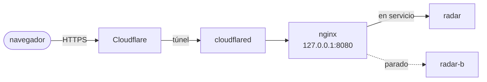
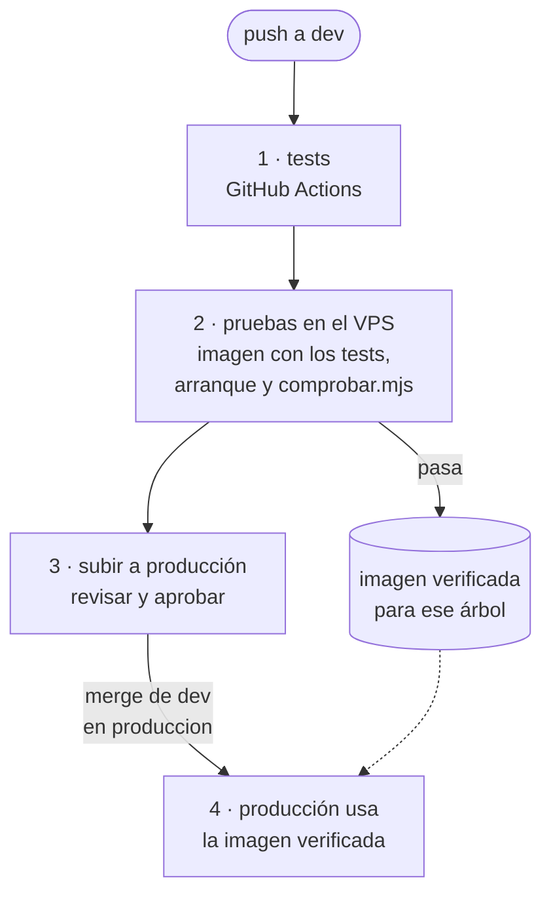

# Despliegue

Radar ES corre en un VPS en contenedores Docker, detrás de un túnel de Cloudflare. El VPS no
tiene puertos web abiertos: el tráfico web entra por el túnel, que conecta desde dentro.

La web va en dos contenedores que se relevan en cada despliegue, `radar` y `radar-b`, y nginx
pasa las visitas al que está en servicio (`data/proxy/activo.conf`). Así un despliegue no corta
nada: no hay 502 de Cloudflare mientras arranca la versión nueva. Si alguna vez no responde
ninguno, nginx enseña `deploy/nginx/actualizando.html` (y la API responde 503 «actualizando», que
la web convierte en un aviso). La página de 502 de Cloudflare no se puede cambiar.

## Ramas

| Rama | Para qué |
|---|---|
| `produccion` | Lo que ejecuta el VPS. **Nunca se trabaja directamente en ella.** |
| `dev` | Integración. Aquí se mergean las ramas de cada mejora, y es lo que corre en pruebas. |
| `feature/…`, `fix/…` | Una por mejora o por arreglo, creada desde `dev`. |

## Del commit a producción

El panel es `.github/workflows/pipeline.yml`. La aprobación es el entorno `produccion` de GitHub
(Settings → Environments): pide la del dueño del repo y sólo admite la rama `dev`. Un push nuevo
a `dev` sustituye al pipeline que estuviera esperando. El VPS marca cada commit con los checks
«Pruebas VPS» (en `dev`) y «Producción» (en el merge), que son los que espera el pipeline; para
eso necesita un token en `.github-token`, que sólo puede escribir el estado de los commits. El merge a mano en la terminal sigue
funcionando igual: producción tampoco lo despliega si no está verificado.

Dos temporizadores lanzan `deploy/actualizar.sh` cada 30 s, uno por entorno. Casi siempre sólo
preguntan a GitHub si la rama ha cambiado (unas décimas de segundo de CPU); la vuelta completa
(vigilar el contenedor, limpieza…) sigue siendo cada 2 minutos. Los temporizadores se copian a
systemd al preparar cada entorno: si cambia un `deploy/*.timer`, hay que volver a instalarlo
(`install -m 644 deploy/radar-actualizar.timer /etc/systemd/system/ && systemctl daemon-reload`
desde la carpeta de producción, y lo mismo con `radar-pruebas.timer` desde la de pruebas). El VPS clona
el repo con una deploy key de solo lectura.

**Pruebas** (`/opt/radar-pruebas`, `radar-pruebas.timer`): si `dev` ha cambiado, construye la
imagen, la arranca y pasa `deploy/comprobar.mjs`, que compara con producción en el mismo
momento:

- todas las fuentes cargadas (hasta 25 min); una que falla también en producción es un fallo de
  la fuente y no para la versión, pero una fuente nueva que no ha leído nunca desde el servidor sí
  la para (puede bloquear la red del VPS aunque desde otras funcione);
- `/api/live` con vehículos (al menos la mitad que en producción) y el resto del directo;
- todas las páginas del sitemap y los ficheros del mapa;
- pico de memoria por debajo de 900 MB (el límite es 1 GB) y ningún reinicio.

Si pasa, la imagen queda como `radar-es-verificado:<árbol>`. Si no, el contenedor se queda
funcionando con el fallo para poder mirarlo. El resultado está en `/opt/radar-pruebas/.estado`.
Cuando producción ya funciona con esa misma imagen, pruebas se para solo (deja de pedir los datos
dos veces) y vuelve a arrancar con el próximo cambio en `dev`.

**Producción** (`/opt/radar`, `radar-actualizar.timer`): si `produccion` ha cambiado, sólo
despliega si ese mismo árbol de ficheros está verificado en pruebas. Un merge de `dev` sin más
cambios deja exactamente el árbol de `dev`, así que lo que sale es la imagen que se ha probado.
Si no está verificado, no toca nada, lo dice una vez en el registro y se despliega solo en cuanto
pruebas lo verifique.

Un despliegue roto no tumba la web (en los dos entornos):

- **Tests**: se pasan dentro de `docker build`. Si fallan no hay imagen nueva y el contenedor
  que funciona no se toca.
- **Relevo**: la versión nueva arranca en el contenedor parado (`radar` o `radar-b`) mientras el
  otro sigue atendiendo. Espera a que responda (hasta 3 min) y a que cada fuente haya hecho su
  primera lectura (hasta 10 min; si alguna tarda más, sigue igualmente), y entonces nginx pasa a
  él con una recarga que no corta ninguna conexión y se para el otro. Si no arranca, se para y
  sigue el de antes, sin haber dejado de atender; el código vuelve al anterior.
- En los dos casos el commit queda en `.fallido` y no se reintenta cada 2 minutos; se vuelve a
  intentar cuando llega otro commit o con `--forzar`.
- **Colgado**: en cada vuelta, si el contenedor en servicio está `unhealthy` (vivo pero sin
  responder, ~2 min seguidos), lo reinicia. Docker sólo reinicia solo los que terminan.
- **Limpieza**: una vez a la semana, producción borra la caché de compilación de Docker de más
  de 7 días y la de paquetes de apt. En `data/` (de producción y de pruebas) borra las teselas del
  mapa que nadie ha vuelto a mirar en 60 días (red ferroviaria) o en 7 (áreas quemadas) y los
  restos de escrituras cortadas. Las imágenes viejas ya se borran en
  cada despliegue (se guardan la anterior y las 5 últimas verificadas).

El resultado de pruebas está en su `.estado`, y los registros de los dos temporizadores
(`journalctl -u radar-pruebas` y `journalctl -u radar-actualizar`) dicen qué se ha comprobado y
desplegado. `deploy/actualizar.sh --forzar` despliega aunque no haya pasado pruebas: sólo para
urgencias.

## Entorno de pruebas, secretos y servidor

- **Pruebas** se monta con `deploy/preparar-pruebas.sh` y no está abierto al público.
- **Secretos**: el `.env` (`NAP_API_KEY`, `ESIOS_TOKEN`, las claves de EMT Madrid, titular y contacto), el token que marca los commits y las
  credenciales del túnel no están en git. El token sólo puede escribir el estado de los commits de
  este repositorio y no va en el `.env`, que también llega al contenedor.
- **`data/`**: cachés de GTFS e histórico. Sobrevive a los redespliegues y, si se pierde, se
  regenera sola.
- Cómo montar el servidor desde cero o recuperarlo, el acceso y la configuración del túnel están
  documentados fuera del repositorio.

### Paso a dos contenedores (una sola vez)

El primer despliegue con nginx lo hace todavía el `actualizar.sh` anterior, que sólo conoce el
servicio `radar`: con el `compose.yaml` nuevo recrea `radar` (ya sin el puerto 8080) y arranca
nginx, que lo ocupa. Ese despliegue tiene el corte de siempre (segundos); desde el siguiente, el
`actualizar.sh` nuevo hace el relevo sin corte. No hay que tocar cloudflared: sigue apuntando a
`127.0.0.1:8080` (producción) y `127.0.0.1:8081` (pruebas).

Lo medido en una copia local del VPS, con peticiones cada 0,2 s: el paso a dos contenedores, un
corte de menos de un segundo; un despliegue normal, ninguna petición fallida; una versión que no
arranca, ninguna (sigue la anterior). Los cambios en `deploy/nginx/` se recargan sin corte; si
cambia la definición del servicio `proxy` en `compose.yaml`, nginx se recrea con un corte de menos
de un segundo.
